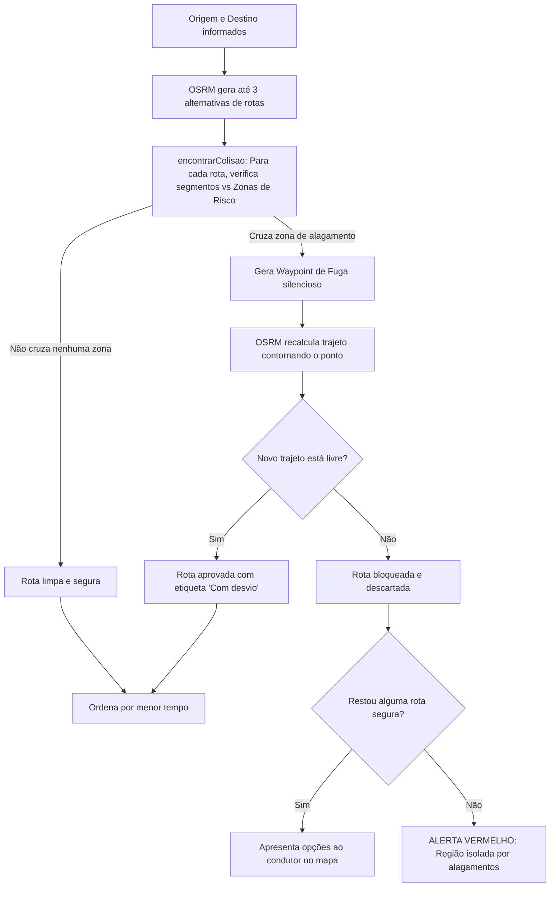

# Plataforma Preditiva de Rotas — Navegação Segura ABC

Plataforma inteligente de roteamento e navegação ponto a ponto desenvolvida em **Next.js** e **Leaflet**, voltada especialmente para a região do **Grande ABC Paulista**. O foco central da aplicação é identificar áreas críticas com risco de alagamento e enchentes cadastradas em tempo real e calcular rotas seguras e desvios automáticos antes e durante o trajeto.

---

## 📌 Sumário
- [Visão Geral](#-visão-geral)
- [Arquitetura e Tecnologias](#-arquitetura-e-tecnologias)
- [Estrutura de Pastas](#-estrutura-de-pastas)
- [Como Funciona a Lógica da Aplicação](#-como-funciona-a-lógica-da-aplicação)
  - [1. Obtenção e Mapeamento das Zonas de Risco](#1-obtenção-e-mapeamento-das-zonas-de-risco)
  - [2. Busca e Autocompletação Localizada](#2-busca-e-autocompletação-localizada)
  - [3. Cálculo de Rotas e Modos de Transporte](#3-cálculo-de-rotas-e-modos-de-transporte)
  - [4. Algoritmo de Detecção de Colisão e Desvio de Alagamentos](#4-algoritmo-de-detecção-de-colisão-e-desvio-de-alagamentos)
  - [5. Geração de Instruções Manobra a Manobra em Português](#5-geração-de-instruções-manobra-a-manobra-em-português)
  - [6. Navegação em Tempo Real, Snap-to-Route e Filtro de GPS](#6-navegação-em-tempo-real-snap-to-route-e-filtro-de-gps)
  - [7. Câmera Imersiva (Visão 3D Heading-Up)](#7-câmera-imersiva-visão-3d-heading-up)
  - [8. Suporte a PWA (Progressive Web App)](#8-suporte-a-pwa-progressive-web-app)
- [Como Executar o Projeto](#-como-executar-o-projeto)
  - [Com Bun](#com-bun-recomendado)
  - [Com Node.js / NPM](#com-nodejs--npm)
  - [Acesso na Rede Local (Mobile)](#acesso-na-rede-local-mobile)

---

## 🧭 Visão Geral

Nas cidades do Grande ABC Paulista (Santo André, São Bernardo do Campo, São Caetano do Sul, Diadema, Mauá, Ribeirão Pires e Rio Grande da Serra), episódios de chuvas intensas frequentemente causam alagamentos em vias arteriais, paralisando o tráfego e colocando veículos e pedestres em perigo.

A plataforma resolve isso integrando um motor de rotas viárias com as coordenadas de pontos suscetíveis a cheias. Se uma rota ótima cruzar uma área de perigo, o algoritmo traça um ponto de escape silencioso (*waypoint de fuga*), contornando o alagamento e priorizando a segurança do condutor.

---

## 🛠 Arquitetura e Tecnologias

- **Framework Web:** [Next.js 16](https://nextjs.org/) (App Router, Turbopack, React 19).
- **Mapas e Renderização Geoespacial:** [Leaflet](https://leafletjs.com/) e [Leaflet Routing Machine](https://www.liedman.net/leaflet-routing-machine/).
- **Serviço de Roteamento:** Servidores públicos [OSRM (Open Source Routing Machine)](https://project-osrm.org/) com perfis especializados para cada modalidade.
- **Geocodificação e Autocomplete:** API [Komoot Photon](https://photon.komoot.io/) baseada no OpenStreetMap, com delimitação geográfica (Bounding Box) no ABC.
- **Banco de Dados (Zonas de Risco):** [Supabase](https://supabase.com/) (`@supabase/supabase-js`) alimentando as zonas de alagamento em tempo real.
- **PWA (Progressive Web App):** `@ducanh2912/next-pwa` para instalação direta em smartphones (Android/iOS) e suporte a execução standalone com tela cheia.
- **Estilização e UI:** CSS in JS integrado (`globals.css` + CSS customizado no componente) com tema *glassmorphism*, controle de safe-area mobile e Tailwind CSS 4.

---

## 📂 Estrutura de Pastas

```text
plataforma-preditiva-rotas/
├── app/
│   ├── favicon.ico             # Ícone do navegador
│   ├── globals.css             # Estilos globais e Tailwind
│   ├── layout.tsx              # Layout raiz, fontes e metadados PWA
│   ├── MapaABC.js              # NÚCLEO DA APLICAÇÃO: Mapa, OSRM, GPS, 3D e desvios
│   ├── page.tsx                # Página principal com carregamento dinâmico do mapa (SSR: false)
│   ├── page(teste)/            # Protótipo de testes da interface isolada
│   └── supabase.js             # Inicialização do cliente Supabase com credenciais
├── components/
│   └── InterfaceEnchentes.tsx  # Componente alternativo de UI para alertas da Defesa Civil
├── public/
│   ├── icon.png                # Ícone da aplicação para Web e PWA (512x512)
│   ├── manifest.json           # Manifesto PWA (nome, cores de tema, ícone, standalone)
│   └── ... (SVGs padrão)
├── next.config.ts              # Configuração do Next.js com plugin PWA habilitado
├── package.json                # Dependências e scripts de inicialização
└── README.md                   # Documentação detalhada da aplicação
```

---

## 🧠 Como Funciona a Lógica da Aplicação

### 1. Obtenção e Mapeamento das Zonas de Risco
- Ao montar o componente `MapaABC.js`, é feita uma consulta à tabela `zonas_risco` no **Supabase**:
  ```javascript
  const { data } = await supabase.from('zonas_risco').select('*');
  ```
- Cada registro traz coordenadas (`latitude`, `longitude`). O sistema converte os dados e plota círculos vermelhos translúcidos no mapa com raio padrão de **150 metros** (`RAIO_RISCO_M = 150`), com popup indicativo: *"⚠️ Zona de Alagamento"*.
- Essas zonas alimentam a referência `zonasRiscoRef`, usada constantemente pelo motor de cálculo de rotas.

---

### 2. Busca e Autocompletação Localizada
- O usuário pode digitar endereços nos campos de **Origem** e **Destino** ou usar o botão **"Meu Local"** (ícone de mira).
- **Debounce de Digitação:** A busca dispara após `350ms` de inatividade e no mínimo `3` caracteres digitados (`MIN_CHARS = 3`).
- **Bounding Box Restrito:** Para evitar que o autocomplete sugira ruas de outras cidades ou estados, a requisição ao serviço Photon restringe os resultados com o parâmetro:
  ```text
  bbox=-46.75,-23.95,-46.30,-23.50
  ```
  Isso mantém as sugestões estritamente focadas na Região Metropolitana de São Paulo / Grande ABC.
- **Localização Rápida no iOS/Safari:** O botão "Meu local" invoca `navigator.geolocation.getCurrentPosition` imediatamente no evento `onClick` do usuário (requisito obrigatório de gesto explícito no WebKit/iOS), centralizando o mapa na posição atual.

---

### 3. Cálculo de Rotas e Modos de Transporte
A aplicação suporta 4 modalidades de deslocamento, chaveando dinamicamente o endpoint do OSRM:

| Modalidade | Identificador | Endpoint / Perfil OSRM | Visualização no Mapa |
|---|---|---|---|
| 🚗 **Carro** | `driving` | `routed-car/route/v1` | Linha sólida azul marinho |
| 🚶 **A pé** | `foot` | `routed-foot/route/v1` | Linha pontilhada verde |
| 🚲 **Bicicleta** | `bike` | `routed-bike/route/v1` | Linha sólida laranja |
| 🚌 **Transporte Público** | `transit` | Rota Mista Multi-modal | Cores segmentadas por modal |

#### Rota Mista de Transporte Público:
Quando o modo `transit` é selecionado, a aplicação calcula o trajeto viário e aplica a lógica de decomposição (`simularRotaMista`):
- Caminhada inicial até o ponto de embarque (velocidade média de 1.4 m/s).
- Trecho principal de ônibus (velocidade média de 5.5 m/s).
- Em trajetos com mais de 6 km (`total >= 6000m`), inclui automaticamente baldeação para trem/metrô (velocidade média de 10 m/s).
- Caminhada final até o destino.
- *(O código já possui pontos de extensão preparados — marcados como `[GTFS-1]` e `[GTFS-2]` — para integração direta com APIs reais de transporte público como OpenTripPlanner, Google Routes ou feeds GTFS da SPTrans/EMTU/CPTM).*

---

### 4. Algoritmo de Detecção de Colisão e Desvio de Alagamentos

O núcleo preditivo da plataforma reside na prevenção geométrica de rotas que passam por áreas de perigo:



1. **Cálculo de Projeção Segmento-Ponto (`projetarNoSegmento`):**
   Converte coordenadas geográficas para projeção cartesiana local em metros (`111.320m` por grau de latitude). Avalia a menor distância euclidiana entre cada segmento da rota e o centro de cada círculo de inundação.
2. **Gatilho de Fuga (`OFFSET_FUGA = 0.003`):**
   Se o segmento passa a menos de `150m` do centro da cheia, calcula-se um ponto intermediário deslocado e uma nova rota é solicitada ao roteador (`semAlternativas: true`).
3. **Descarte de Duplicatas:**
   Desvios que convergem para geometrias redundantes são unificados comparando a distância acumulada e a coordenada média do percurso.
4. **Alerta de Perigo:**
   Se todas as alternativas forem bloqueadas por inundações, o painel exibe um aviso sonoro/visual destacado: *"ALERTA: A área está bloqueada e não há desvios seguros"*.

---

### 5. Geração de Instruções Manobra a Manobra em Português
Em vez de depender de traduções padrão do Leaflet Routing Machine, a plataforma conta com um gerador especializado em língua portuguesa (`textoInstrucaoPt`):
- **Flexão de Gênero Gramatical das Vias (`generoDaVia`):**
  Identifica o prefixo do logradouro e gera preposições corretas no português falado no Brasil:
  - *Feminino:* "Vire à direita **na** Avenida dos Estados", "Continue **pela** Rua das Figueiras".
  - *Masculino:* "Vire à esquerda **no** Viaduto Juvenal Fontanella", "Siga **pelo** Rodoanel".
- **Manobras e Saídas de Rotatórias:**
  Calcula direções cardeais ("Siga para o norte"), bifurcações ("Na bifurcação, mantenha-se à direita") e número da saída em rotatórias ("pegue a 2ª saída").

---

### 6. Navegação em Tempo Real, Snap-to-Route e Filtro de GPS
Ao clicar em **"Ir Agora"**, inicia-se o rastreamento contínuo por `navigator.geolocation.watchPosition`:

1. **Snap-to-Route (Colagem na Rota):**
   Para evitar que o jitter natural do GPS mostre o condutor "andando sobre as calçadas ou casas", o ponto do GPS é projetado ortogonalmente no segmento mais próximo da rota selecionada dentro de uma janela móvel (`idxRotaRef`), mantendo a navegação monotonicamente progressiva.
2. **Filtro de Ruído e Sensibilidade:**
   - Deslocamentos inferiores a `3 metros` (`LIMIAR_DESLOCAMENTO_M`) são filtrados para evitar tremores no mapa enquanto o condutor estiver parado no semáforo.
   - Variações angulares menores que `10 graus` são atenuadas.
3. **Ângulo Desenrolado (*Unwrapped Angle*):**
   Calcula a menor transição angular entre leituras para que a rotação da seta e do mapa não dê giros completos desnecessários de 360° ao cruzar a fronteira norte (359° ⇄ 1°).
4. **Detecção Fora da Rota:**
   Se a distância entre o veículo e a rota ultrapassar `60 metros`, o painel exibe um aviso com o botão **"Recalcular daqui"**, disparando novo trajeto a partir da posição atual do condutor.
5. **WakeLock de Tela:**
   Utiliza a API `navigator.wakeLock.request('screen')` para impedir que a tela do smartphone apague durante o trajeto.

---

### 7. Câmera Imersiva (Visão 3D Heading-Up)
Durante a navegação ativa, o condutor pode alternar entre a **Visão Superior (2D)** e a **Visão Imersiva (3D)**:
- A cena utiliza projeção de perspectiva CSS:
  ```css
  transform: perspective(1000px) rotateX(55deg) rotateZ(var(--mabc-giro));
  ```
- O mapa é rotacionado no sentido oposto ao vetor de deslocamento do carro (*Heading-Up*: a rua pela qual você trafega sempre fica orientada para o topo da tela).
- **Compensação de Ponto de Fuga (`offsetCameraPx`):**
  Como a inclinação de 55° empurraria o centro geométrico para o meio da tela, a fórmula trigonométrica desloca o ponto focal em pixels para que o marcador do veículo permaneça confortável no terço inferior da tela (`MARCADOR_ALTURA_TELA = 0.75`), oferecendo ampla visão das próximas curvas e cruzamentos à frente, acompanhada por um gradiente de névoa no horizonte (`.mabc-ceu`).

---

### 8. Suporte a PWA (Progressive Web App)
- Configurado via `@ducanh2912/next-pwa` no arquivo `next.config.ts`.
- Manifesto em `public/manifest.json` com nome `Navegação Segura ABC`, ícone adaptado de 512x512px e `display: standalone`.
- Metadados configurados no `app/layout.tsx` para suporte nativo em iOS (Safari Web App) e Android (Chrome PWA).

---

## 🚀 Como Executar o Projeto

### Pré-requisitos
- Um ambiente com **Bun** (versão 1.1+) ou **Node.js** (versão 18+).

### Com Bun (Recomendado)

1. Instalar as dependências:
   ```bash
   bun install
   ```

2. Iniciar o servidor de desenvolvimento:
   ```bash
   bun run dev
   ```

3. Abrir no navegador:
   - [http://localhost:3000](http://localhost:3000)

---

### Com Node.js / NPM

1. Instalar as dependências:
   ```bash
   npm install
   ```

2. Iniciar o servidor de desenvolvimento:
   ```bash
   npm run dev
   ```

---

### Acesso na Rede Local (Mobile)

Para testar os recursos de geolocalização e visão 3D diretamente no seu celular conectado à mesma rede Wi-Fi:

1. Inicie o servidor escutando em todas as interfaces de rede (`0.0.0.0`):
   ```bash
   bun run dev -- -H 0.0.0.0
   ```
   *(ou com npm: `npm run dev -- -H 0.0.0.0`)*

2. Verifique o IP da sua máquina na rede local (`ipconfig` no Windows ou `ifconfig` no Linux/Mac).
3. No navegador do smartphone, acesse:
   ```text
   http://<SEU-IP-LOCAL>:3000
   ```
   *(Exemplo: `http://192.168.15.10:3000`)*

> [!NOTE]
> No iOS e em versões modernas do Android/Chrome, algumas APIs como `navigator.geolocation` exigem origem segura (HTTPS ou `localhost`). Para testes avançados de GPS externo no celular, utilize um túnel HTTPS (como Ngrok, Cloudflare Tunnel ou mkcert local).
