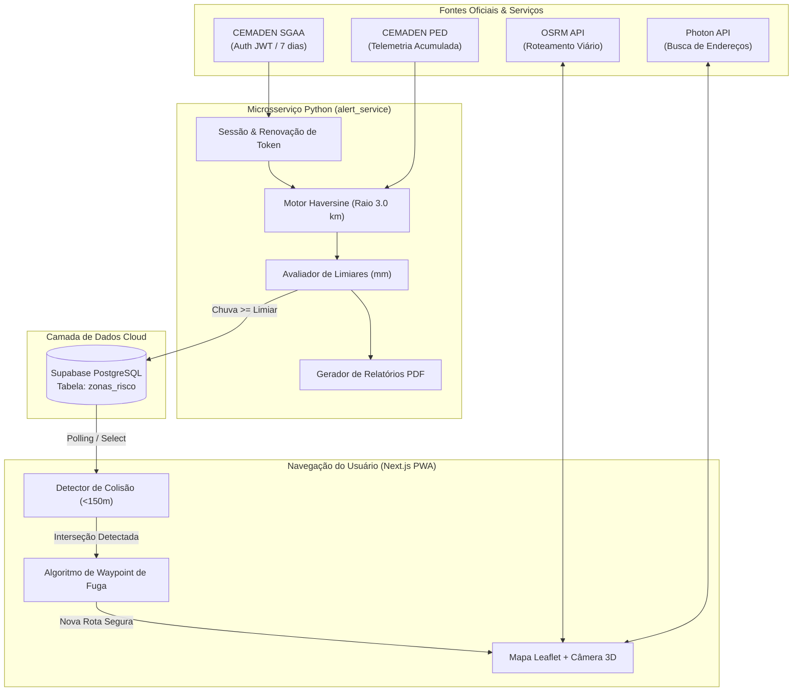
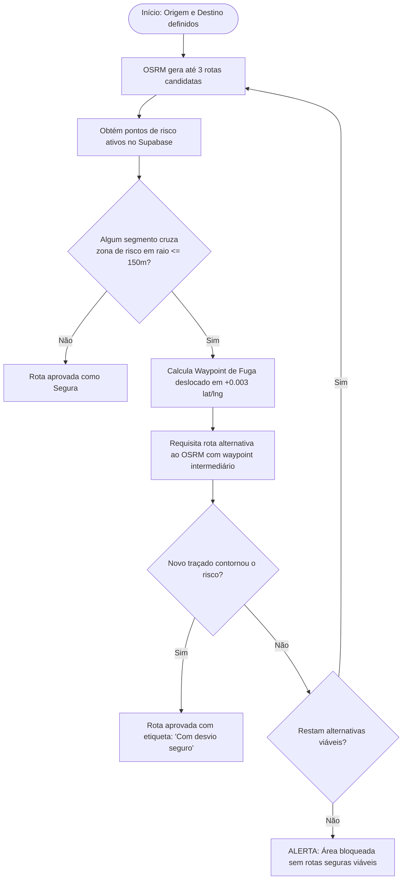

# Relatório Técnico de Projeto — Plataforma Preditiva de Rotas
**Sistema Inteligente de Navegação e Prevenção de Alagamentos no Grande ABC Paulista**  
*Documento de Apresentação e Avaliação Acadêmica*

---

## 1. Etapas de Desenvolvimento e Organização das Tarefas

O desenvolvimento foi conduzido seguindo metodologia incremental, estruturado nas seguintes etapas:

```
[Etapa 1: Elicitação & Dados Históricos] ➔ [Etapa 2: Motor de Roteamento PWA] ➔ 
[Etapa 3: Banco de Dados Supabase]       ➔ [Etapa 4: Microsserviço alert_service] ➔ 
[Etapa 5: Automação SGAA & PDF]          ➔ [Etapa 6: Validação & Testes Integrados]
```

| Etapa | Atividade / Escopo | Entregas Geradas |
|---|---|---|
| **1. Pesquisa e Dados** | Análise de histórico de inundações em Santo André (bacia do Tamanduateí) e mapeamento de pluviômetros do CEMADEN. | `alagamentos_abc_historico.csv`<br>`pluviometros_santo_andre.csv`<br>`vulnerabilidade_alagamentos_santo_andre.csv` |
| **2. Frontend & Roteamento** | Criação do aplicativo PWA (Next.js + Leaflet) com motor OSRM e algoritmo de desvio de rotas em tempo real. | `app/MapaABC.js`<br>`app/layout.tsx`<br>`public/manifest.json` |
| **3. Persistência de Dados** | Modelagem da tabela `zonas_risco` no Supabase e cliente de comunicação frontend. | `app/supabase.js`<br>Esquema SQL da tabela |
| **4. Microsserviço de Alertas** | Implementação do serviço autônomo em Python (`alert_service`) para ingestão da API do CEMADEN e cálculo de influência espacial (Haversine 3 km). | `alert_service/alert.py`<br>`alert_service/main.py`<br>`pyproject.toml` |
| **5. Automação de Acesso & PDF** | Autenticação no CEMADEN SGAA com renovação de token (HTTP 401) e gerador de relatórios em PDF com emojis. | `alert_service/report_pdf.py`<br>`alert_service/.env.example` |
| **6. Testes e Documentação** | Simulação de chuvas extremas, validação de evasão de rota e elaboração da documentação técnica. | Suíte de testes CLI (`--simular`, `--once`)<br>`README.md` |

---

## 2. Materiais, Componentes, Ferramentas e Tecnologias

| Categoria | Tecnologia / Ferramenta | Finalidade no Projeto |
|---|---|---|
| **Frontend Web / PWA** | Next.js 16 (React 19, Turbopack) | Interface responsiva, SSR/CSR híbrido e suporte a Progressive Web App. |
| **Estilização** | Tailwind CSS 4 + Glassmorphism | Design moderno de alta legibilidade para motoristas em trânsito. |
| **Mapas e Geodésia** | Leaflet + Leaflet Routing Machine | Renderização cartográfica, manipulação de camadas geoespaciais e GPS. |
| **Roteamento e Geocoding**| OSRM + Komoot Photon API | Cálculo de rotas rodoviárias/pedestres e busca textual restrita ao Grande ABC. |
| **Banco de Dados Cloud** | Supabase (PostgreSQL Gerenciado) | Armazenamento relacional dos pontos ativos de inundação (`zonas_risco`). |
| **Microsserviço de Coleta**| Python 3.10+ (Poetry / Pip) | Ingestão periódica de dados hidrometeorológicos e análise de risco. |
| **Fonte de Telemetria** | CEMADEN (WebServices SGAA / PED) | Dados oficiais em tempo real de 20 estações pluviométricas em Santo André. |
| **Relatórios Executivos** | ReportLab 5.1 + Segoe UI Emoji | Geração automática de relatórios de auditoria em PDF com suporte a emojis. |
| **Ambiente Operacional** | Windows 11 / Linux (Cross-platform) | Plataforma de desenvolvimento e execução dos serviços. |

---

## 3. Desenhos, Esquemas e Diagramas de Arquitetura

### 3.1. Arquitetura Geral do Sistema
O sistema opera em duas frentes desacopladas: a **camada de ingestão/monitoramento** (backend Python) e a **camada de navegação do usuário** (frontend PWA).



---

### 3.2. Fluxo Lógico do Algoritmo de Evasão de Alagamentos



---

### 3.3. Esquema do Banco de Dados (`zonas_risco`)

```sql
CREATE TABLE public.zonas_risco (
    id BIGINT GENERATED BY DEFAULT AS IDENTITY PRIMARY KEY,
    latitude DOUBLE PRECISION NOT NULL,
    longitude DOUBLE PRECISION NOT NULL,
    status TEXT DEFAULT 'alerta',
    created_at TIMESTAMP WITH TIME ZONE DEFAULT timezone('utc'::text, now()) NOT NULL
);

-- Índice geoespacial / numérico para consultas rápidas de raio
CREATE INDEX idx_zonas_risco_coords ON public.zonas_risco (latitude, longitude);
```

---

## 4. Códigos Desenvolvidos — Trechos Essenciais Comentados

> *Nota: Os arquivos completos com todo o código-fonte estão disponíveis nos arquivos do repositório: [`app/MapaABC.js`](file:///c:/Users/isacb/OneDrive/Documentos/Dev/plataforma-preditiva-rotas/app/MapaABC.js), [`alert_service/alert.py`](file:///c:/Users/isacb/OneDrive/Documentos/Dev/plataforma-preditiva-rotas/alert_service/alert.py) e [`alert_service/report_pdf.py`](file:///c:/Users/isacb/OneDrive/Documentos/Dev/plataforma-preditiva-rotas/alert_service/report_pdf.py).*

### 4.1. Detecção de Colisão e Desvio de Rota (`app/MapaABC.js`)

O trecho abaixo implementa o cálculo geométrico ponto-a-segmento entre a rota planejada e a mancha de inundação, inserindo o ponto de fuga silencioso:

```javascript
// Verifica se o trajeto cruza o raio de risco (150m) de alguma zona alagada
function rotaCruzaZona(rota, zonas) {
    const coordenadas = rota.coordinates || [];
    for (const zona of zonas) {
        const centro = { lat: zona.lat, lng: zona.lng };
        for (let i = 0; i < coordenadas.length - 1; i++) {
            // Distância ortogonal do ponto de alagamento ao segmento da via
            if (distanciaPontoSegmentoM(centro, coordenadas[i], coordenadas[i + 1]) <= RAIO_RISCO_M) {
                return zona; // Colisão detectada
            }
        }
    }
    return null;
}

// Aplica o Waypoint de Fuga e força o OSRM a calcular novo trajeto
if (zonaColidida) {
    const pontoFuga = L.latLng(zonaColidida.lat + OFFSET_FUGA, zonaColidida.lng + OFFSET_FUGA);
    const novasRotas = await rotearViaRouter(router, [origem, pontoFuga, destino]);
    // A rota recalculada agora contorna a mancha de água
}
```

---

### 4.2. Mapeamento Espacial Haversine e Avaliação de Limiar (`alert_service/alert.py`)

Calcula a distância geodésica na esfera terrestre (WGS84) e correlaciona as leituras pluviométricas das estações próximas aos pontos vulneráveis:

```python
def haversine_km(lat1, lon1, lat2, lon2):
    """Calcula a distância geodésica em km entre duas coordenadas geográficas."""
    R = 6371.0  # Raio médio da Terra em km
    dlat, dlon = math.radians(lat2 - lat1), math.radians(lon2 - lon1)
    a = math.sin(dlat / 2)**2 + math.cos(math.radians(lat1)) * math.cos(math.radians(lat2)) * math.sin(dlon / 2)**2
    return R * (2 * math.atan2(math.sqrt(a), math.sqrt(1 - a)))

# Avaliação do limiar pluviométrico
chuva_relevante = max(maior_chuva_1h, maior_chuva_24h * 0.5)
if chuva_relevante >= ponto["tolerancia_mm"]:
    # Dispara inserção no Supabase caso ainda não esteja ativo
    inserir_alerta_supabase(supabase_url, supabase_key, ponto["latitude"], ponto["longitude"])
```

---

### 4.3. Renovação Automática de Token do CEMADEN SGAA (`alert_service/alert.py`)

Garante a resiliência contínua do serviço contra expiração periódica do JWT:

```python
class CemadenSessao:
    def consultar_acumulados(self, codibge):
        token = self.obter_token()
        try:
            return consultar_cemaden_acumulados(self.ped_url, token, codibge)
        except urllib.error.HTTPError as e:
            # Token expirado (401): renova no SGAA e repete a consulta imediatamente
            if e.code == 401 and self.email and self.password:
                print("⚠️ Token expirado (HTTP 401). Renovando via SGAA...")
                token = self.obter_token(forcar_renovacao=True)
                return consultar_cemaden_acumulados(self.ped_url, token, codibge)
            raise
```

---

### 4.4. Instruções de Instalação, Configuração e Execução

#### Frontend (Next.js PWA)
```bash
# Instalação das dependências
npm install   # ou bun install

# Execução em ambiente de desenvolvimento
npm run dev   # ou bun run dev
# Disponível em: http://localhost:3000
```

#### Backend / Serviço de Alertas (`alert_service`)
```bash
cd alert_service

# Configurar variáveis de ambiente
cp .env.example .env

# Execução com Poetry (Recomendado)
poetry install
poetry run python main.py --once        # Execução de teste única
poetry run python main.py --simular     # Teste simulado de tempestade
poetry run python main.py               # Execução contínua a cada 10 min

# Alternativa via pip nativo
pip install -r requirements.txt
py main.py --once
```

---

## 5. Procedimentos de Teste e Critérios de Avaliação do Protótipo

A validação do protótipo foi efetuada através de cenários controlados de testes funcionais e de integração:

| ID | Cenário de Teste | Procedimento Executado | Critério de Sucesso | Resultado |
|---|---|---|---|---|
| **TC-01** | **Evasão de Zona de Risco** | Traçar rota entre Av. Industrial e Centro passando pela Av. Firestone (ponto com alerta ativo no Supabase). | O algoritmo deve rejeitar a rota direta e apresentar rota alternativa com desvio rotulado. | **Aprovado ✅** |
| **TC-02** | **Consumo de API Real CEMADEN** | Executar `main.py --once` conectado à internet com credenciais SGAA ativas. | Resposta HTTP 200 contendo telemetria das 14 estações pluviométricas em operação no município. | **Aprovado ✅** |
| **TC-03** | **Tolerância a Token Expirado** | Forçar token inválido (`--cemaden-token "invalido"`) em chamada real. | Captura do erro HTTP 401, acionamento do SGAA, obtenção de novo JWT e conclusão da rodada sem crash. | **Aprovado ✅** |
| **TC-04** | **Disparo em Cascata (Tempestade)**| Executar `main.py --once --simular` simulando 35mm a 60mm de chuva. | Disparo de alertas para todos os 7 pontos vulneráveis e geração dos inserts simulados no mock. | **Aprovado ✅** |
| **TC-05** | **Geração de Relatório PDF** | Avaliar geração de `alert_service/relatorio_alertas.pdf` após cada rodada. | PDF íntegro compilado com tabelas de risco, métricas e emojis renderizados corretamente. | **Aprovado ✅** |
| **TC-06** | **Compatibilidade Mobile PWA** | Acessar via smartphone em rede local (`bun run dev -- -H 0.0.0.0`), testando orientação 3D e GPS. | Câmera inclinada a 55° (*heading-up*), GPS snap-to-route responsivo e tela sem desligar (WakeLock). | **Aprovado ✅** |

---

## 6. Custos e Alterações Realizadas Durante o Desenvolvimento

### 6.1. Levantamento de Custos do Projeto
Toda a infraestrutura foi planejada para operar com custo financeiro direto nulo (**R$ 0,00**), utilizando tecnologias livres e tiers gratuitos de serviços em nuvem:

| Recurso / Serviço | Fornecedor / Tecnologia | Custo Financeiro |
|---|---|---|
| **Hospedagem de Banco de Dados** | Supabase (Free Tier - 500 MB PostgreSQL) | R$ 0,00 |
| **Roteamento e Malha Viária** | OpenStreetMap / OSRM (Servidor Público Open Source) | R$ 0,00 |
| **Geocodificação e Autocomplete** | Komoot Photon API (Dados OSM abertos) | R$ 0,00 |
| **Dados Pluviométricos Oficiais** | CEMADEN / Governo Federal (Serviço Público Aberto) | R$ 0,00 |
| **Frameworks e Bibliotecas** | Next.js, React, Tailwind, Leaflet, Python, Poetry, ReportLab | R$ 0,00 (Open Source) |
| **Total do Protótipo** | — | **R$ 0,00** |

---

### 6.2. Alterações Realizadas Durante o Desenvolvimento

Durante os ciclos de testes e refinamento do projeto, foram realizadas as seguintes decisões de engenharia:

1. **Migração de Web Scraping para API Oficial (`scraper/` ➔ `alert_service/`)**:
   - *Motivo:* Inicialmente cogitou-se extrair dados por raspagem de tela. A solução foi descartada em favor dos webservices oficiais REST do CEMADEN (SGAA e PED), reduzindo latência, consumo de banda e risco de quebra por mudanças de layout.
2. **Automação do Ciclo de Vida do Token JWT**:
   - *Motivo:* Os tokens fornecidos pelo CEMADEN expiram a cada 7 a 10 dias. Implementou-se a classe `CemadenSessao` que renova o token automaticamente via requisição HTTP POST ao endpoint SGAA caso ocorra `HTTP 401`, eliminando manutenção manual.
3. **Criação do Modo Mock no Banco de Dados (`MOCK_SUPABASE=true`)**:
   - *Motivo:* A chave pública (`anon`) do Supabase possui permissões restritas a `SELECT` por políticas de segurança RLS. O modo mock permitiu testar toda a lógica de disparo de alertas sem depender da concessão da chave administrativa `service_role`.
4. **Substituição da Saída de Terminal por Relatório PDF Executivo**:
   - *Motivo:* Apenas exibir logs no console dificultava auditorias de segurança e apresentações. Desenvolveu-se o módulo `report_pdf.py` com ReportLab e suporte a fontes Unicode/Emojis (`Segoe UI Emoji`), gerando relatórios de alta qualidade visual para órgãos públicos ou defesa civil.
5. **Ajuste de Resiliência de Estações Offline**:
   - *Motivo:* Das 20 estações cadastradas em Santo André, constatou-se que apenas 14 transmitiam dados em tempo real no momento dos testes. A lógica espacial foi configurada para correlacionar múltiplas estações vizinhas (raio de 3 km) a cada ponto crítico, evitando pontos cegos caso um pluviômetro esteja fora do ar.
